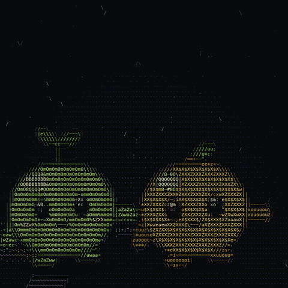
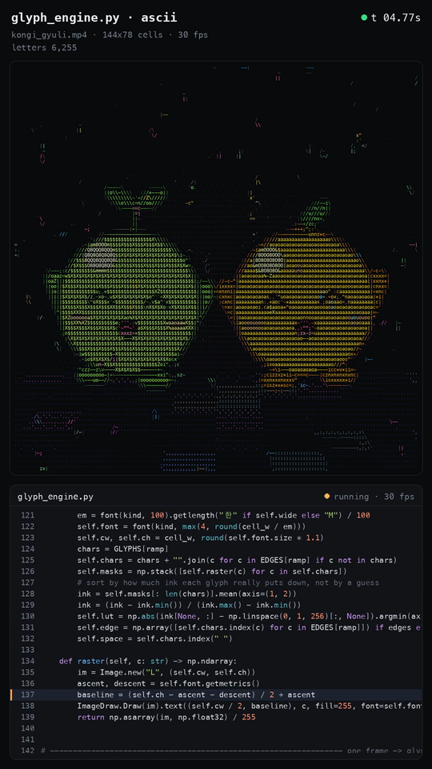
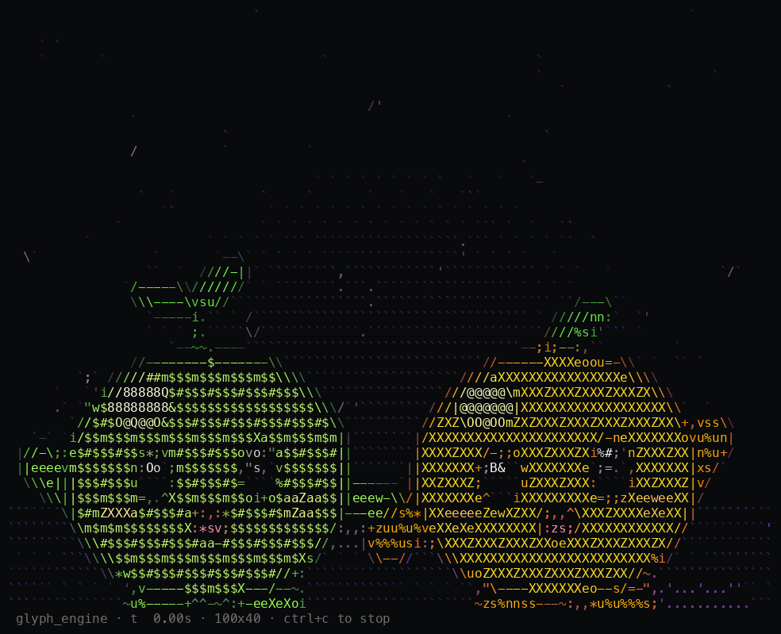

# glyph_engine

영상을 **컬러 아스키 아트 영상**으로 바꿔 주는 작은 파이썬 엔진입니다. 터미널에서 실시간으로 재생할 수도 있어요.

<p align="center">
  
</p>

프레임마다 각 칸의 밝기에 맞는 글자(`. : ; + = * o a e m # % & 8 @`)를 고르고,
윤곽선 위에는 방향에 맞는 획(`| / - \`)을 놓은 뒤 원본 색을 입힙니다.

| 스튜디오 레이아웃 (1080×1920 영상) | 터미널 실시간 재생 |
|:---:|:---:|
|  |  |

## 준비

- **macOS** 기준 (Menlo, Apple SD Gothic Neo 폰트 사용 — 다른 OS는 `glyph_engine.py`의 `FONTS`에 폰트 경로를 추가)
- **Python 3.9+**
- **ffmpeg** (`ffprobe`, 터미널 재생 소리용 `ffplay` 포함)

```bash
brew install ffmpeg
```

```bash
python3 -m venv .venv && .venv/bin/pip install -r requirements.txt
```

## 빠르게 해보기

1. 데모 영상 만들기 — 오리지널 캐릭터 **콩이(완두콩 새싹) & 귤이(귤)** 의 댄스 + 직접 합성한 칩튠 (`demo/kongi_gyuli.mp4`)

   ```bash
   .venv/bin/python make_demo.py
   ```

2. 아스키 아트 영상으로 변환 → `out/kongi_gyuli.glyph.mp4`

   ```bash
   .venv/bin/python glyph_engine.py demo/kongi_gyuli.mp4
   ```

3. 터미널에서 실시간 재생 (소리 포함, `ctrl+c`로 종료)

   ```bash
   .venv/bin/python glyph_engine.py demo/kongi_gyuli.mp4 --play --loop --fill
   ```

내 영상도 그대로 넣으면 됩니다: `.venv/bin/python glyph_engine.py 내영상.mp4` → `out/내영상.glyph.mp4`

## 옵션

| 옵션 | 설명 |
|---|---|
| `--layout studio` / `full` | studio: 1080×1920 (헤더 + 그림 + 코드 패널), full: 그림만 원본 비율로 |
| `--ramp ascii` / `hangul` | 영문 글자 / 한글(뭉·한·뷁…)로 그리기 |
| `--cols N` | 가로 글자 수. 크면 촘촘하고 정밀, 작으면 글자가 크게 보임 (기본 144) |
| `--theme dark` / `paper` | 검은 배경에 빛나는 글자 / 종이에 잉크 (밝은 영상에 어울림) |
| `--no-edges` | 윤곽선 획 없이 밝기만으로 |
| `--start S --duration D` | 구간만 변환 |
| `--still T` | T초 지점 한 장만 PNG로 (느낌을 빠르게 확인할 때) |
| `--play [--loop] [--mute]` | 터미널 실시간 재생 (실제 터미널 창에서 실행해야 해요) |
| `--fill` | `--play`에서 터미널 전체를 채움 (그림 가장자리를 잘라 더 크게) |
| `--gamma --black --sat --gain --dither --edge --edge-share` | 밝기·채도·윤곽 감도 미세 조정 |

전체 목록은 `.venv/bin/python glyph_engine.py -h`

## 동작 방식

1. **읽기** — ffmpeg가 프레임을 `열×4, 행×8` 크기로 줄여서 넘겨줌 (글자 칸 하나당 4×8 샘플)
2. **밝기 → 글자** — 칸의 평균 밝기로 글자를 고름. 글자 순서는 폰트로 직접 그려 본 잉크 양으로 정렬
3. **윤곽** — Sobel로 밝기 경계의 방향을 구해, 경계 위 칸에는 그 방향의 획 `| / - \` 를 놓음.
   한두 칸짜리 어두운 점(눈·입)은 획으로 두르지 않고 구멍으로 남겨서 작은 화면에서도 얼굴이 보이게
4. **칠하기** — 글자 마스크에 칸 색을 입혀 numpy로 한 번에 합성 → ffmpeg로 인코딩 (원본 소리 유지)
5. **스튜디오 화면** — 시간·글자 수 헤더, 그리고 엔진 자신의 소스 코드가 아래 패널에서 실행되듯 스크롤

## 파일 구성

| 파일 | 내용 |
|---|---|
| `glyph_engine.py` | 엔진 — 영상 → 아스키 아트 영상 / 터미널 재생 |
| `make_demo.py` | 데모 영상 생성기 (Pillow로 그린 캐릭터 애니메이션 + numpy 칩튠) |
| `requirements.txt` | numpy, pillow |
| `docs/` | README 미리보기 이미지 |

`demo/`, `out/`의 영상은 위 명령으로 언제든 다시 만들 수 있어서 저장소에는 넣지 않았어요.

## 팁

- 터미널이 작으면 글자 수가 모자라 그림이 뭉개져요. 창을 키우거나 `cmd -`로 글꼴을 줄인 뒤 다시 실행하면 훨씬 또렷해집니다 (크기는 재생을 시작할 때 정해져요).
- 24비트 컬러를 지원하는 터미널(iTerm2, Ghostty, WezTerm 등)에서 가장 예쁘게 보여요.
